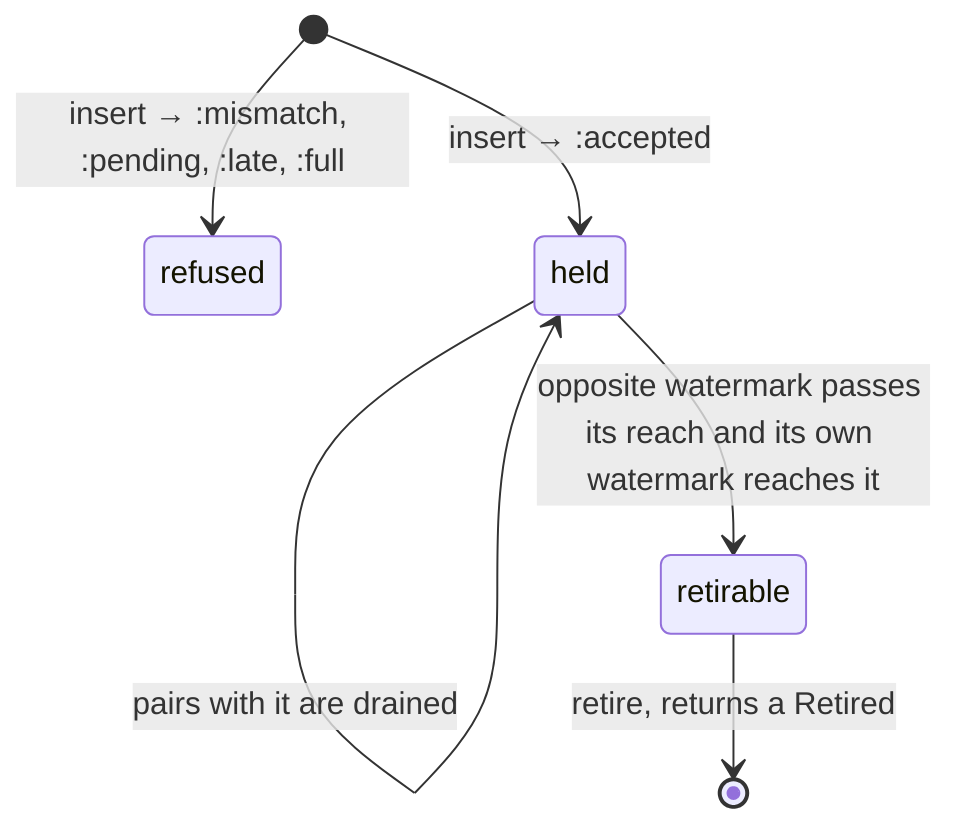
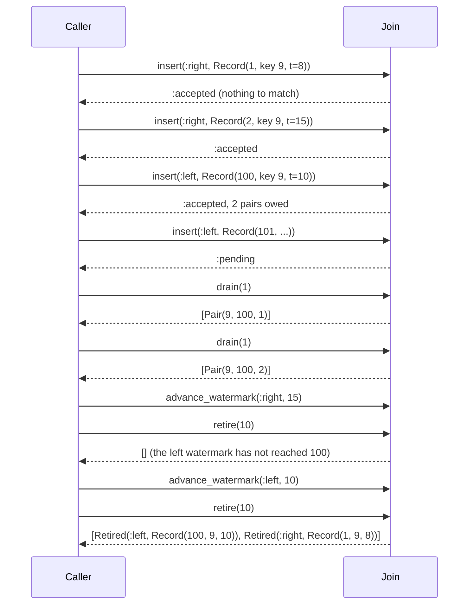

# JoinMachines

> Two streams, one key, and a window of time in which they are allowed to meet. 🤝

An interval-join ledger for Ruby. You tell it about every record on two inputs: an id, a key, an event time. It tells you which left and right records share a key and landed close enough in time, hands you those pairs in batches as small as you like, and tells you which records can never match anything again so you can throw their payloads away. It never sees a payload. It keeps the bookkeeping, you keep the data.

This is an initial, unstable API. It is a policy core, not a stream processor.

## Quick Start

```bash
gem 'join_machines'
```

```ruby
# A click joins an impression of the same ad shown up to 30 s before it.
join = JoinMachines::Join.new(JoinMachines::Bounds.new(before: 30_000, after: 0))

def on_record(join, side, record, store)
  case join.insert(side, JoinMachines::Record.new(record.id, record.ad_id, record.event_ms))
  when :late      then return count_late(record)
  when :mismatch  then return count_conflict(record) # this id is held with other contents
  when :full      then raise 'join is full: advance the watermarks and retire'
  end # :accepted, or :duplicate for a replay of a held record: nothing new is owed
  store[side][record.id] = record

  until (pairs = join.drain(100)).empty?
    pairs.each { |pair| emit(store[:left][pair.left], store[:right][pair.right]) }
  end
end

def on_watermark(join, side, event_ms, store)
  join.advance_watermark(side, event_ms)
  until (gone = join.retire(100)).empty?
    gone.each { |r| store[r.side].delete(r.record.id) }
  end
end
```

Ids, keys, and times are Integers. Time is event time in whatever unit you pick, as long as both inputs agree. Each side's watermark speaks for its own input only: one input running well ahead of the other makes nothing `:late` on the slower one.

## A Message to the Resistance

So you have impressions on one topic and clicks on another, and somebody in a meeting said "just join them." Thirty seconds of attribution window. How hard can it be.

You put the impressions in a hash by ad id. A click arrives, you look it up, you emit. Then you notice the hash only grows, so you add a sweeper that deletes anything older than thirty seconds by the wall clock. Then a consumer lags for a minute, the sweeper deletes impressions whose clicks are still sitting in the partition, and attribution quietly drops by four percent. Nothing raises. The dashboard just gets a little sadder.

So you stop sweeping by wall clock and sweep by event time. Whose event time? The click that arrives after the sweep was allowed to be up to thirty seconds *behind* the impression's stream, not its own. Then one hot key matches nine thousand buffered records at once and the handler that was supposed to emit "a pair" blocks the consumer while it emits nine thousand.

The piece you keep rebuilding is small: which records are held, which pairs are owed, and when is a record provably finished. With a hard bound on all three. That piece is this gem.

## Chapter 1: Stardate 2026.316, the AMS Widom

> **AMS Widom**, NCC-4232, *Widom*-class stream tender.
> Two convoys pass in the dark. The tender logs who was abeam of whom, and for how long it still matters.

The tender carries no cargo. Freighters from two lanes report in as they pass: hull number, consignment code, time of passage. The tender's log pairs every hull on one lane with every hull on the other that carried the same code within the agreed interval, and strikes a hull from the log only when the other lane's traffic control certifies that nothing that early is still inbound.

On a bridge somewhere, a cadet volunteers:

```ruby
def on_click(click)
  impression = @impressions[click.ad_id]
  emit(impression, click) if impression && click.at - impression.at <= 30
end

every(30.seconds) { @impressions.delete_if { |_, i| i.at < Time.now - 30 } }
```

"That," says the tender's logkeeper, "is a join whose correctness depends on nobody ever being late. Have you met a convoy?"

## The Flight Plan

Each record the join holds goes through this:



And the join as a whole only ever owes pairs for one record at a time:



## How the Join Works

### Bounds

```ruby
bounds = JoinMachines::Bounds.new(before: 2, after: 5)   # or Bounds.new(2, 5)
join = JoinMachines::Join.new(bounds)
join.bounds                # => #<data JoinMachines::Bounds before=2, after=5>
bounds.reach(:left, 10)    # => #<data JoinMachines::Reach first=8, last=15>
bounds.reach(:right, 10)   # => #<data JoinMachines::Reach first=5, last=12>
bounds.reach(:left, 10).include?(15)   # => true
JoinMachines.other(:left)  # => :right
```

A left record at time `t` matches right records with the same key at times `t - 2` through `t + 5`, both ends included. `Bounds.new(0, 0)` is an exact-time join. `Join.new` takes the `Bounds` value, the way the core's constructor does; the bounds are fixed for the life of the join. `reach(side, timestamp)` is the range of opposite-side times a record on `side` can match.

### Insert

```ruby
Record = JoinMachines::Record            # id, key, timestamp

join.insert(:right, Record.new(1, 9, 8))     # => :accepted
join.insert(:right, Record.new(2, 9, 15))    # => :accepted
join.insert(:right, Record.new(3, 9, 16))    # => :accepted
join.insert(:left, Record.new(100, 9, 10))   # => :accepted
join.pending?                                # => true
join.pending_pairs                           # => 2
```

`insert(side, record)` takes a `Record`, the same value `retire` hands back. An accepted record is held, and the join now owes one pair for every held record on the other side with the same key inside the interval. The ids are yours. They only have to be unique among the records currently held on the same side.

Replaying a record the join still holds is fine. The same id with the same key and timestamp answers `:duplicate`: honoured, nothing changes, and no pair is owed a second time. The same id with a different key or timestamp answers `:mismatch`, a refusal. A held id is answered this way before anything else is looked at, so a replay is `:duplicate` even while pairs are owed or after the side's watermark has passed the record.

```ruby
join.insert(:left, Record.new(100, 9, 10))   # => :duplicate, already held, still owes 2 pairs
join.insert(:left, Record.new(100, 9, 11))   # => :mismatch, id 100 is held with timestamp 10
```

Held means held right now. A record that matched and was drained is still held. A record that was retired is not, but it cannot come back: it was let go only after its own side's watermark had reached it, and that watermark never moves back, so the same record replayed is `:late`, every time, and no pair is handed over twice. The join does this without keeping any history, which also means it does not remember the id itself: a *different* record under a retired id is judged like any new one. Keep one id for one record and replays across retirement are safe.

### Drain

```ruby
join.drain(1)   # => [#<data JoinMachines::Pair key=9, left=100, right=1>]
join.pending?   # => true
join.drain(8)   # => [#<data JoinMachines::Pair key=9, left=100, right=2>]
join.pending?   # => false
join.drain(8)   # => []
```

`drain(max)` hands over at most `max` owed pairs. Whatever didn't fit stays owed, in order, and the next call picks up exactly where this one stopped. Every pair comes out once. While pairs are owed, `insert` and `retire` answer `:pending`:

```ruby
join.insert(:left, Record.new(101, 9, 14))   # => :accepted, owes pairs with 2 and 3
join.insert(:left, Record.new(102, 9, 14))   # => :pending
join.drain(8).size                           # => 2
```

### Watermarks

```ruby
join.advance_watermark(:right, 14)            # => :advanced
join.advance_watermark(:right, 14)            # => :repeated, already there, nothing changed
join.advance_watermark(:right, 13)            # => :watermark_regressed, time went backwards
join.watermark(:right)                        # => 14
join.watermark(:left)                         # => nil
join.insert(:right, Record.new(4, 9, 14))     # => :late
join.insert(:right, Record.new(4, 9, 15))     # => :accepted
join.drain(8)
```

Each side has its own watermark: your promise that no more records at or below that time will arrive on that side. The join holds you to it. A record at or below its own side's watermark is `:late` and is not held. The *other* side's watermark never makes a record late: if its partner is still held, the record is accepted and the pair is owed, however far apart the two watermarks are. Advancing a watermark removes nothing by itself. Repeating the value a side already holds is not a refusal: the promise you are making already stands, so the answer is `:repeated`. Only a value behind the side's watermark is refused, with `:watermark_regressed`.

If you already track a stream's progress in a watermark object, hand it over instead of unwrapping it:

```ruby
clicks = WindowMachines::Watermark.new   # from the window_machines gem, if you use it
clicks.advance(14)                            # => :advanced
join.advance_watermark_from(:right, clicks)   # => :repeated, the side already agrees
join.watermark(:right)                        # => 14
join.side_watermark(:right)                   # => #<data JoinMachines::Watermark value=14>
join.side_watermark(:left)                    # => #<data JoinMachines::Watermark value=nil>
```

`advance_watermark_from(side, watermark)` reads `watermark.value` and answers like `advance_watermark`: `:advanced` when the side moved up to it, `:repeated` when the side already equals it, `:watermark_regressed` and no change when it is behind. Any object with a `value` reader returning an Integer or `nil` works; this gem does not depend on `window_machines`. A `WindowMachines::Watermark` fits as it is, whether you advanced it yourself, built it with `Watermark.at(saved)`, or took the copy `Sessions#watermark` answers; only its `value` is read, and it is never advanced for you. A `nil` value means nothing was observed yet: `:repeated` while the side is `nil` too, `:watermark_regressed` once the side has a value. An object without `value` raises `TypeError`.

`side_watermark(side)` is the other direction: the side's progress as a `JoinMachines::Watermark`, a frozen `Data` with the one reader `value` (an Integer, or `nil` before the first watermark). That is exactly the shape `advance_watermark_from` reads, so one join's side can be handed to another join. It is a copy taken at the call, not a live view, and it does not advance; `watermark(side)` is the same number without the wrapper.

### Retire

```ruby
join.retirable                       # => 0
join.advance_watermark(:right, 15)   # left 100 reached right times 8..15
join.retirable                       # => 0, a replay of left 100 would not be late yet
join.advance_watermark(:left, 10)    # now it would be; right 1 reached left times 3..10
join.retirable                       # => 2
join.retire(10)
# => [#<data JoinMachines::Retired side=:left,
#       record=#<data JoinMachines::Record id=100, key=9, timestamp=10>>,
#     #<data JoinMachines::Retired side=:right,
#       record=#<data JoinMachines::Record id=1, key=9, timestamp=8>>]
```

A held record is finished when two things are true. The *other* side's watermark has reached the last time it could match (`timestamp + after` for a left record, `timestamp + before` for a right one, stopping at `2**64-1`), so nothing that can still arrive pairs with it. And its *own* side's watermark has reached its timestamp, so the same record offered again is `:late`. The first makes dropping it lossless, the second makes it final. A record whose own side lags stays held until that side catches up. `retire(max)` removes up to `max` finished records and tells you which, so you can drop their payloads: each `Retired` is the `side` and the `Record` (`id`, `key`, `timestamp`) that was held. Anything over `max` stays `retirable` for the next call.

### Capacity

```ruby
JoinMachines::CAPACITY   # => 64
join.capacity(:left)     # => 64
join.capacity(:right)    # => 64
join.size(:left)         # => 1
```

Each side holds 64 records. Past that, `insert` says `:full`. A record is never evicted to make room, because evicting it would silently lose its future pairs. Advance the watermarks, retire, and try again, or shard by key across joins.

## The Rules of the Tender

- **Ids, keys, times, bounds, and limits are Integers** in `0..2**64-1`. Floats, nil, and strings raise `TypeError`. Out of range raises `RangeError`. A side that isn't `:left` or `:right` raises `ArgumentError` (or `TypeError` if it isn't a Symbol).
- **Refusals don't raise.** `:mismatch`, `:pending`, `:late`, `:full` and `:watermark_regressed` are answers, each with its own symbol and no catch-all, and a refused call changes nothing. Only malformed input raises.
- **Every answer, by method.**

  | Method | Honoured | Refused |
  | --- | --- | --- |
  | `insert(side, record)` | `:accepted`, or `:duplicate` when exactly that record is already held | `:mismatch`, `:pending`, `:late`, `:full` |
  | `drain(max)` | an Array of `Pair`, `[]` when none is owed | never refuses |
  | `advance_watermark(side, value)` | `:advanced`, or `:repeated` when the side already held `value` | `:watermark_regressed` |
  | `advance_watermark_from(side, watermark)` | `:advanced`, or `:repeated` when the side already equals it | `:watermark_regressed` |
  | `retire(max)` | an Array of `Retired`, `[]` when none is retirable | `:pending` |
- **Arguments are the core's values.** `Join.new` takes a `Bounds`, `insert` takes a `Record`. A Hash, an Array or loose Integers in their place raise `TypeError` or `ArgumentError`.
- **Repeats are honoured only while provable.** `:duplicate` means the join holds that exact record on that side right now, and changes nothing. It is never a refusal. A retired record leaves no trace, so a replay of it is not `:duplicate`; it is `:late`, because its own side's watermark had reached it before it was let go and never moves back.
- **One record's pairs at a time.** Drain what the last insert owes before inserting or retiring.
- **Late is judged on one watermark. Retirement is judged on both.** A record is `:late` at or below its own side's watermark and for no other reason, so a record whose partner is held is never turned away because of the other input. `retire` releases a held record at `t` only when the other side's watermark is at or past the end of its reach (`>= bounds.reach(side, t).last`: nothing still to come can match it) *and* its own side's watermark is at or past `t` (a replay is `:late`). So nothing matchable is ever refused, a retired record replayed is `:late` for good, and every pair is handed over exactly once.
- **A lagging side keeps its records.** A side whose own watermark is behind holds its records longer, however far the other side has run, and a side whose watermark never moves retires nothing. That costs slots, never pairs: the bound is the capacity, and past it `insert` says `:full`. Advance both watermarks to release records.
- **Time saturates at the edges.** A reach that would run below 0 or past `2**64-1` stops there.
- **Frozen means frozen.** `freeze` the join and `insert`, `drain`, `advance_watermark`, `advance_watermark_from`, and `retire` raise `FrozenError`.

## What You Think You're Doing vs Reality

### You Think: "I'll expire old records after the window has passed."
### Reality: Passed according to whom?

Your wall clock says thirty seconds went by. The click stream, three partitions behind, has not been told. A record is finished when the stream it is waiting on says it has moved on, and the only thing that can say that is that stream's watermark. `retire` asks that, and asks the record's own stream whether it could still be delivered again.

### You Think: "A record matches, I emit a pair."
### Reality: A record matches four hundred, and your output buffer holds fifty.

A join's output per input is not bounded by one. `drain(max)` makes the batch size your decision, and keeps the remainder owed instead of dropped or buffered somewhere you can't see.

## What's Yours

The payloads. The join stores three Integers per record and nothing else, so you keep a store keyed by side and id and delete from it when `retire` says so. Hashing a wide key down to an Integer is also yours, and so is checking the real key on a pair if your hash can collide.

The watermarks. The join believes them. Advance one too eagerly and that side's own records come back `:late`; the other side's never do. Never advance one and both sides fill up and stay `:full`.

Everything else a stream processor does: reading inputs, running the user's function on a pair, checkpointing, restoring after a crash. The join lives in your process and forgets everything when the process does. Pairs you drained before a crash are not remembered as drained by anyone but you.

## License

MIT License. See [LICENSE.txt](LICENSE.txt) for details.

**Remember: the record you swept on a timer was thirty seconds old. Its match was thirty-one seconds late.**
